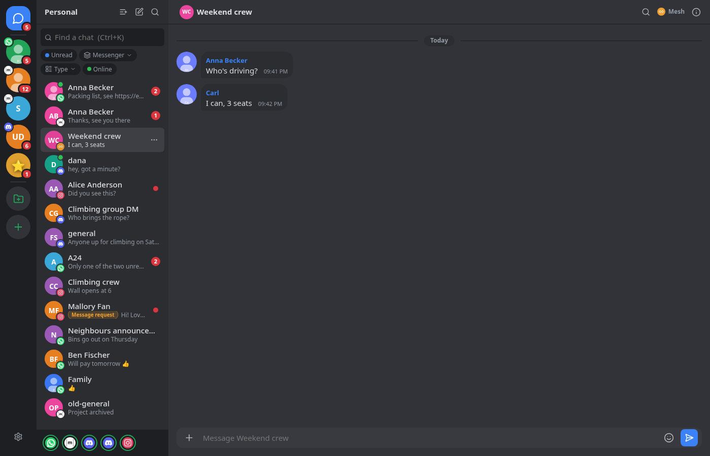
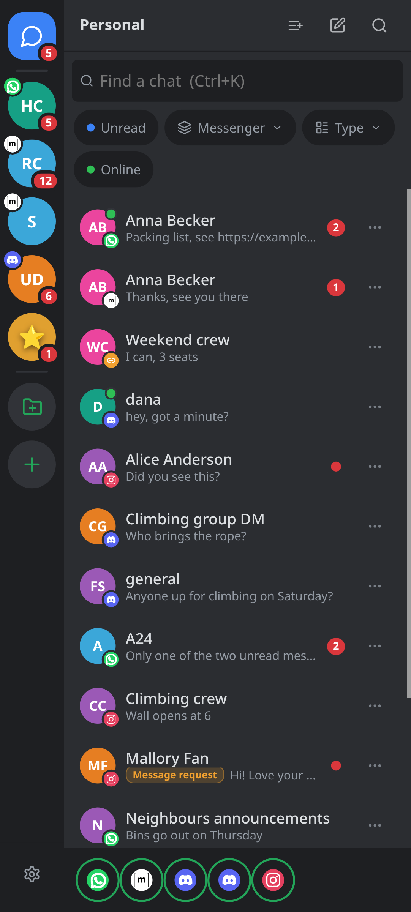
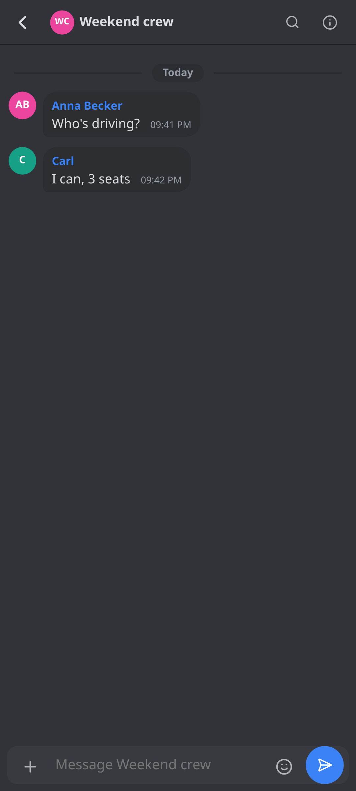

# UniChat

One app for WhatsApp, Signal, Matrix, Mattermost, Instagram and Discord (more messengers plug in the same way): a Discord-style UI with a rail of communities,
personal chats, polls, reactions, attachments, locations, contact cards, mesh groups that span platforms, a local encrypted
message archive, and read-only archives for accounts you signed out of.

## Screenshots

Mock data (`?mock`), no real accounts. **[Try the demo](https://pixelcrafterexe.github.io/unichat/)** — the same mock data, running in your browser with no backend and nothing to install.

<p>
  
  
  
</p>

## Install on Arch Linux

Every release carries a pacman package. Download `unichat-desktop-<version>.pkg.tar.zst` from the [latest release](https://github.com/PixelcrafterEXE/unichat/releases/latest) and install it:

```
sudo pacman -U unichat-desktop-<version>.pkg.tar.zst
```

Or build it the AUR way from the `PKGBUILD` attached to the same release (`unichat-bin`, pins the package's sha256):

```
mkdir unichat-bin && cd unichat-bin
gh release download --repo PixelcrafterEXE/unichat --pattern PKGBUILD
makepkg -si
```

Updates: the app's built-in updater notifies about new releases; install the new package the same way. A Flatpak (`unichat-desktop-<version>.flatpak`) is attached as well.

## Run it

```
pnpm install                         # needs pnpm >= 11 and Node >= 22.13
pnpm --filter @unimsg/server dev     # backend on ws://127.0.0.1:8765/ws  (data in ~/.config/unimsg)
pnpm --filter @unimsg/ui dev         # UI on http://localhost:5173
```
Open http://localhost:5173, click **+** → *Add an account*. Add `?mock` to the URL to try the UI with fake data and no accounts.

Environment (backend): `UNIMSG_DATA` (data dir), `HOST`/`PORT`, `UNIMSG_TOKEN` (required when HOST is not loopback),
`UNIMSG_ALLOWED_ORIGINS` (hosted UI origins), `UNIMSG_DB_KEY` (32-byte archive key, hex/base64; otherwise a 0600 key file is
created next to the data), `UNIMSG_DEBUG=1` (counts-only provider diagnostics on stderr).

## Check it

```
pnpm -r typecheck
pnpm --filter @unimsg/core test  &&  pnpm --filter @unimsg/store-sqlite test
pnpm --filter @unimsg/provider-whatsapp test  # likewise provider-signal, provider-matrix
```
The pnpm workspace sets `blockExoticSubdeps: false` because Baileys (WhatsApp) depends on a git-hosted `libsignal-node` fork.
Build scripts (Electron download, esbuild, protobufjs) are skipped by pnpm 11+; the web UI and server do not need them.

## Version numbers

Releases are numbered by CI and nothing else: `release.yml` builds `0.1.<github.run_number>` and tags it. A build made on a
developer's machine must never take one of those numbers -- the installed app would claim to be a release nobody published,
and the updater would have nothing to match it against.

Local builds therefore use `scripts/dev-version.mjs`, which prints `dev-0.1.<next>.<YYYYMMDDHHMM>` from the newest tag
(`--next` prints the release number itself). The stamp matters: without it every local build carried the same version, so
a package manager saw nothing to upgrade and an app that had been installed but never restarted was indistinguishable
from one that was up to date. Settings > Updates shows the string, so the running build can always be named.

On Android the version code has to keep growing, or the phone refuses the update. CI builds use `2000 + run number`; local
builds keep the default from `apps/android/package.json` (0.1.0 -> 100), so an APK from a release can always replace one
built here. Both are signed with the same debug key: CI restores it from the `ANDROID_DEBUG_KEYSTORE_B64` secret and names
it to Gradle explicitly (`UNICHAT_DEBUG_KEYSTORE`), and the release fails if the APK carries any other key. The `dev-` prefix is what `apps/desktop/src/updater.ts` turns into "dev", so such a build reports
itself as a development build and never offers an update:

```sh
export UNICHAT_VERSION=$(node scripts/dev-version.mjs)       # dev-0.1.14
pnpm --filter @unimsg/ui build && pnpm --filter @unimsg/desktop exec electron-vite build
```

## Feature matrix

How to read it: one emoji per cell. A `*` means the notes under the table say more about that cell.
When each cell was last checked against the real service is in `docs/live-results.json`, not in the table.

| Rating | Meaning |
|---|---|
| ✅ Verified | Seen working against the **real service** in this project: by the live test run on the two test chats (WhatsApp "Whatsapp-o-mat" and Signal "Signal-o-mat"), or in daily use. |
| 🧪 Untested | Implemented and covered by unit tests or a fake server, but **not yet run against the real service**. Expect small bugs. |
| ❌ Failing | Tried against the **real service** by the live test (`scripts/live/run.mjs`) and did not work; the note in `docs/live-results.json` says what happened. |
| 🛠️ Unimplemented | The messenger offers it, but UniChat does not do it yet. |
| ⛔ Unsupported | The messenger itself has no such feature (or no way for a third-party client to use it). |
| `*` | There is more about this cell in the notes below the table. |

| Feature | WhatsApp | Signal | Matrix | Mattermost | Instagram | Discord | Teams | Threema |
|---|---|---|---|---|---|---|---|---|
| **Messages** |  |  |  |  |  |  |  |  |
| Receive text | ✅ | ✅ | ✅ | ✅ | 🧪 | 🧪 | 🧪 | 🧪 |
| Send text | ✅ | ✅ | ✅ | 🧪 | 🧪 | 🧪 | 🧪 | 🧪 |
| Live updates (realtime) | ✅ | ✅ | ✅ | ✅ | 🧪 | 🧪 | 🧪 | 🧪 |
| Older history from the service | ✅ | ⛔ | ✅ | ✅ | 🧪 | 🧪 | 🧪 | ⛔ |
| Fetch chat history in bulk (Settings > Storage & downloads, `Capabilities.fetchHistory`) | ✅ | ⛔ | 🧪 | 🧪 | 🛠️ | 🧪 | 🧪 | 🧪 |
| Import old history from a local phone backup (account card > Import chat history; https://github.com/PixelcrafterEXE/unichat/wiki/WhatsApp-history-import, https://github.com/PixelcrafterEXE/unichat/wiki/Signal-history-import) | 🧪* | ✅* | ⛔ | ⛔ | ⛔ | ⛔ | ⛔ | ⛔ |
| Full-text search of the local archive (SQLite FTS5, operators, snippets) | ✅ | ✅ | 🧪 | 🧪 | 🧪 | 🧪 | 🧪 | 🧪 |
| Replies / quotes | ✅ | ✅ | ✅ | 🧪 | 🧪 | 🧪 | 🧪 | 🧪 |
| Reactions (send + show) | ✅ | ✅ | ✅ | 🧪 | 🧪 | 🧪 | 🧪 | 🧪 |
| Pin messages (pin / unpin, pinned bar, list) | ✅ | ✅ | 🧪* | 🧪* | ⛔ | 🧪* | 🧪* | ⛔ |
| Edit own message | ✅ | ✅ | ✅ | 🧪 | 🛠️ | 🧪 | 🧪 | 🧪 |
| Delete own message for everyone | ✅ | ✅ | ✅ | 🧪 | 🧪 | 🧪 | 🧪 | 🧪 |
| Typing indicators | ✅ | ✅ | ✅ | 🧪 | 🧪 | 🧪 | ⛔ | 🧪 |
| Online status (presence): green dot, "online" / "last seen" for 1:1 contacts | 🧪* | ⛔* | 🧪* | 🧪* | 🛠️ | 🧪* | ⛔ | ⛔ |
| Chat list filters: Unread / Messenger / Type (personal, groups, community channels) | ✅* | ✅ | ✅ | ✅ | ✅ | ✅ | 🧪 | 🧪 |
| "Online" filter (only 1:1 chats whose contact is online) | 🧪* | ⛔* | 🧪* | 🧪* | 🛠️ | 🧪* | ⛔ | ⛔ |
| Read receipts (see who read) | ✅ | ✅ | ✅ | ⛔ | 🧪 | ⛔ | ⛔ | 🧪 |
| Mark chat read on the service | ✅ | ✅ | ✅ | 🧪 | 🧪 | 🧪 | 🧪 | 🧪 |
| Custom emoji / animated emoji | ⛔ | ⛔ | 🧪 | 🧪 | ⛔ | 🧪 | ⛔ | ⛔ |
| @mentions when sending | ✅ | ✅ | ✅ | 🧪 | 🧪 | 🧪 | 🧪 | 🧪 |
| Link previews when sending | ❌* | ✅ | 🧪 | ⛔ | 🧪 | 🧪 | ⛔ | ⛔ |
| Disappearing / view-once messages | ✅ | ✅ | ⛔ | ⛔ | 🛠️ | ⛔ | ⛔ | 🛠️ |
| **Media** |  |  |  |  |  |  |  |  |
| Receive images, video, files | ✅ | ✅ | ✅ | 🧪 | 🧪 | 🧪 | 🧪 | 🧪 |
| Send images, video, files | ✅ | ✅ | ✅ | 🧪 | 🧪 | 🧪 | 🧪 | 🧪 |
| Play voice messages | ✅ | 🧪 | ✅ | ⛔ | 🧪 | 🧪 | ⛔ | 🛠️ |
| Send voice messages | ✅ | ✅ | ✅ | ⛔ | 🧪 | 🧪 | ⛔ | 🛠️ |
| GIFs | ❌* | ❌* | 🧪 | 🧪 | 🧪 | 🧪 | 🧪 | ⛔ |
| Stickers (receive) | 🧪 | 🧪 | 🧪 | ⛔ | 🧪 | 🧪 | ⛔ | 🧪 |
| **Rich content** |  |  |  |  |  |  |  |  |
| Polls: show and vote | ✅ | ✅ | ✅ | ⛔ | 🛠️ | 🧪 | ⛔ | 🧪 |
| Location sharing | ✅ | ⛔ | ✅ | ⛔ | ⛔ | ⛔ | ⛔ | 🧪 |
| Contact cards (vCard) | ✅ | ✅ | ⛔ | ⛔ | ⛔ | ⛔ | ⛔ | ⛔ |
| Events / calendar invites | ✅ | ⛔ | ⛔ | ⛔ | ⛔ | 🧪 | ⛔ | ⛔ |
| Voice and video calls | 🛠️ | 🛠️ | 🛠️ | 🛠️ | 🛠️ | 🛠️ | 🛠️ | 🛠️ |
| **Groups and communities** |  |  |  |  |  |  |  |  |
| Group chats: receive | ✅ | ✅ | ✅ | ✅ | 🧪 | 🧪 | 🧪 | 🧪 |
| Group chats: send | ✅ | 🧪 | ✅ | 🧪 | 🧪 | 🧪 | 🧪 | 🧪 |
| Group name and picture shown | ✅ | ✅ | ✅ | 🧪 | 🧪 | 🧪 | 🧪 | 🧪 |
| Create a group | ✅ | 🧪 | ✅ | 🧪 | 🧪 | 🧪 | 🧪 | 🧪 |
| Add / remove members | 🧪 | 🧪 | ✅ | 🧪 | 🧪 | 🧪 | 🧪 | 🧪 |
| Rename a group | ✅ | 🧪 | ✅ | 🧪 | 🧪 | 🧪 | 🧪 | 🧪 |
| Change group description | ✅ | 🧪 | ✅ | 🧪 | ⛔ | 🧪 | ⛔ | ⛔ |
| Change group picture | ❌* | 🧪 | ✅ | ⛔ | ⛔ | 🧪 | ⛔ | ⛔ |
| Leave a group | ✅ | 🧪 | ✅ | 🧪 | 🧪 | 🧪 | 🧪 | 🧪 |
| Communities / spaces / servers: show | ✅ | ⛔ | ✅ | ✅ | ⛔ | 🧪 | 🧪 | ⛔ |
| Create / join / leave a community | 🧪 | ⛔ | ✅ | 🧪 | ⛔ | 🧪 | 🛠️ | ⛔ |
| **Account** |  |  |  |  |  |  |  |  |
| Link / log in | ✅ | ✅ | ✅ | ✅ | 🧪 | 🧪 | 🧪 | 🧪 |
| Remove account and sign out remotely | ✅ | ✅ | ✅ | 🧪 | 🧪 | 🧪 | 🧪 | 🧪 |
| Profile pictures of people and chats | ✅ | ✅ | ✅ | 🧪 | 🧪 | 🧪 | 🧪 | 🧪 |
| Edit own profile (name, about, picture) | ✅ | ✅ | ✅ | 🧪 | ⛔ | 🧪 | 🛠️ | 🛠️ |
| Identity verification: emoji comparison with another device or a person, incoming requests, cross-signing + recovery-key set-up, "verify with recovery key" (Settings > Accounts, contact panel) | ⛔ | ⛔ | 🧪* | ⛔ | ⛔ | ⛔ | ⛔ | ⛔ |
| Privacy settings | ✅ | ✅ | ✅ | ⛔ | 🧪 | 🧪 | ⛔ | 🧪 |
| Start a chat with a new contact | 🧪 | ✅ | ✅ | 🧪 | 🧪 | 🧪 | 🧪 | 🧪 |
| Block a contact | 🧪 | 🧪 | ✅ | ⛔ | 🧪 | 🧪 | ⛔ | 🧪 |
| Message requests inbox | ⛔ | ⛔ | ⛔ | ⛔ | 🧪 | ⛔ | ⛔ | ⛔ |
| End-to-end encrypted by the messenger | ✅ | ✅ | ✅ | ⛔ | ⛔ | ⛔ | ⛔ | 🧪 |

Notes, because one cell cannot say everything:

- **The four ❌ cells** (`docs/live-results.json` has the raw notes): **WhatsApp GIFs** uploaded and came back byte-identical, but WhatsApp showed a still image — it needs an mp4 with `gifPlayback`, which #84 has since added, so this awaits the next live run; a real `.gif` cannot be animated without transcoding and is sent as the still image the recipient sees. **Signal GIFs** uploaded and came back as `image/gif`, but not marked as an animation, so it is shown as a still image. **WhatsApp link previews** send, but no preview card is attached. **WhatsApp "change group picture"** fails with "only admins can, unless the group lets everyone": the server has no image library (install `sharp`) to prepare the picture.
- **Import old history from a phone backup:** WhatsApp reads `msgstore.db.crypt15` / `crypt14` plus the Media folder, implemented from the wa-crypt-tools spec and fixture-tested only, never run on a real backup. Signal reads the Secure Backup on-device folder including media (Verified); the legacy `.backup` file format is fixture-tested only.
- **Pin messages** is fake-server-tested only outside WhatsApp and Signal: Matrix through `m.room.pinned_events`, Mattermost and Discord against their fake servers, Teams for chats but not for channels.
- **Matrix** was verified against a throwaway local Synapse 1.165.0 (25-step suite in `packages/provider-matrix/lab`): that counts as Verified for the rows marked so, but federation, single sign-on and Element-produced events are untested. The new verification dialogs (emoji comparison, set-up, recovery key) are only fake-verified: unit tests with fake SDK objects and UI tests against the mock, never against a real homeserver or a second device. **Instagram** and **Discord** were written against fake servers only; the Instagram and Discord (user-token) modes use unofficial APIs that violate the services' terms (see their READMEs for the risks). **Mattermost** has run live against one server, but only reading, history and display are Verified; sending and the recent fixes (read status sync, custom emoji) are Untested.
- **WhatsApp polls:** votes cast on the phone show up in UniChat (Verified), but votes cast from UniChat do not reach the phone reliably yet, so the cell is Untested (2026-11-14: single/multiple-choice detection, the explicit poll secret on creation and vote replacement were reworked and unit-tested only). **WhatsApp media download-all** now asks the phone to re-upload expired files (`updateMediaMessage`) and the job reports failures per reason; **WhatsApp online status** and on-demand older history from the phone while scrolling are Untested. **WhatsApp communities:** the list and most covers work (live probe); two communities return "no picture" from WhatsApp.
- **WhatsApp voice / GIFs / contact cards / locations** are implemented and unit-tested; sending voice, contact cards and locations has not been confirmed on a phone. **Signal** attachment and voice-message sending, Signal group sending (fan-out to each member) and group name/picture were built from the protocol without a live send check (group name and picture did resolve on a live run). Signal cannot fetch old history (a linked device only receives new messages), so UniChat keeps its own archive.
- **Edit on Instagram** is marked Unimplemented from the API knowledge available when it was written; Instagram has been adding edit and polls for DMs, so verify before relying on it.
- **Read receipts on Mattermost and Discord** do not exist per message. Both can still mark a chat as read on the service, which is a separate row (Mattermost's was fixed after you reported read status not syncing, and is Untested).
- **Presence** (`Capabilities.presence`, `Connector.setPresenceEnabled`, core event `presence`): kept in memory only, never archived, shown as a green dot on 1:1 avatars (list, header, member list, contact panel) and as "online" / "last seen ..." text. Every provider's presence is fake-server-tested only, never against a real service. Settings > Privacy > "Show who is online" (default on) turns the whole thing off: connectors stop asking, events are dropped. UniChat never announces your own status. Matrix: passes on `m.presence` of people you have a 1:1 room with and asks `GET /presence/{user}/status` for at most 40 such peers every 5 minutes (sequential, stops after 3 refusals; many homeservers, matrix.org among them, disable presence, then nothing is shown). Mattermost: one `POST /users/status/ids` per minute for the peers of your direct messages. Discord: user accounts only (friends' `PRESENCE_UPDATE`, only for people you have a DM with; online/idle/dnd = online, offline/invisible = offline; the READY_SUPPLEMENTAL initial list is a hypothesis); bots would need the privileged GUILD_PRESENCES intent, so they report none. Signal has no presence at all. Instagram, Teams, Threema: not implemented. WhatsApp: see its provider.
- **Chat list filters** are a UniChat-side feature that works the same for every messenger, so the row is one verdict for all of them, tested against the mock (bar above the list; local, remembered in the UI settings, combine with AND): *Unread* (chats with unread messages; muted ones only with "+ muted"), *Messenger* (pick one or more accounts), *Type* (all / personal chats / groups / community channels = chats that live in a community or folder), *Online* (only shown when a connected account supports presence, so that row inherits the state of the presence row above it). They apply to every view (Personal, communities, folders): a rail icon whose view has no matching chat is dimmed but still clickable, and an empty list offers "Clear filters". A merged chat matches Messenger / Online if any member does. The "Find a chat" search is independent: while it has text the filters are not applied. A badge on the clear button shows how many filters are active.
- **Full-text search** works on whatever is in the local archive, whatever the messenger. It is a local feature, tested only against synthetic archives and the mock UI (core unit tests, a 500k-message performance run, UI e2e): never run on a real archive yet, hence Untested everywhere. Query syntax: words (prefix match, any case/accents), `"exact phrase"`, `-exclude`, `from:` `in:` `has:image|video|file|voice|link|poll` `after:` `before:`; results are ranked, grouped by chat with highlighted snippets; chat and contact names are matched too. The index is SQLite FTS5 held **in memory only** (rebuilt from the sealed archive at every start, never written to disk); where `node:sqlite`/FTS5 is missing (Android's embedded Node) the same interface falls back to an in-memory scan with identical results. Startup cost on a synthetic 500k-message sealed archive: see `packages/store-sqlite/src/search.perf.ts` (mostly decrypting the archive, not indexing). Languages without spaces (Chinese, Japanese) are matched by whole run of characters from its start only (unicode61 tokenizer).
- **Fetch chat history** (Settings > Storage & downloads, per account, optionally selected chats; last 30 days / 1 year / everything): pages backwards through the provider's `history()` into the archive with a per-messenger pause (Discord about 1 request/s), progress, cancel, resume after a restart, and a summary with failures counted per reason. Offered only where `Capabilities.fetchHistory` is true: Discord, Matrix, Mattermost. Tested against fake connectors only. WhatsApp: its `history()` asks the phone on demand, but the capability stays off until the WhatsApp provider declares it; Instagram is left off on purpose (unofficial API, ban risk).
- **Not per messenger (work for all of them):** mesh groups across platforms, merged chats, folders, the encrypted local archive and read-only archives of signed-out accounts, search, scheduled messages, themes and notifications. Those are tested in UniChat itself, not against a particular messenger.
- This table is meant to be kept current: when a cell is confirmed on a real account, change it to Verified.
